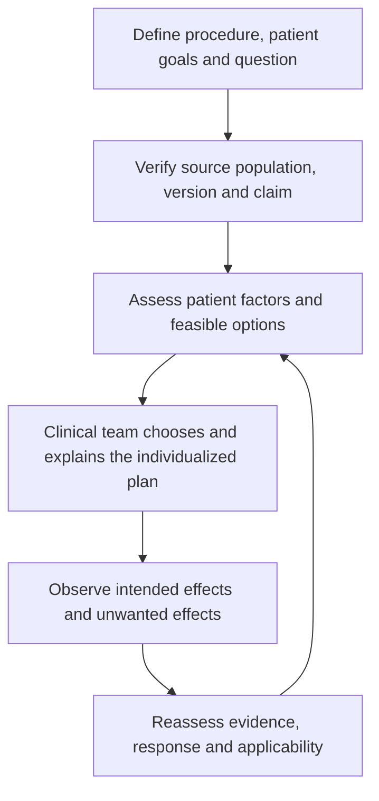

# Breast perioperative learning: applied cases

28 October 2026. Assessment, counseling, regional/nonopioid choices, operative-site coverage and recovery; source populations are distinguished.

All examples are entirely synthetic, independent of real encounters, charts or shadowing observations. They illustrate source-informed reasoning, not observed administrations, validated treatment plans, standardized drug regimens or clinical competence. Male/female labels are descriptive; any difference in the discussion follows history, procedure and evidence applicability rather than sex alone. Female cases are nonpregnant unless explicitly stated otherwise.

## Shared example set and method

Read [the local anesthesia-options case set](ANESTHESIA_OPTIONS_AND_CASES.md) for the same four-modality comparison, 12 general teaching cases, medication roles/routes, monitoring distinctions and decision flows used throughout this portfolio. The topic-specific pairs below apply that format to this repository.

Standardize the reasoning: identify the clinical question → verify source/version and population → distinguish published recommendation from fictional inference → assess patient-specific alternatives and monitoring → reassess effects and harms. A DOI establishes an identifier, not the truth or clinical suitability of every inferred decision. Source verification here covers identities and available abstracts/selected passages; it is not an exhaustive full-text systematic appraisal.

## BR-01 — Preoperative assessment and shared choice

- **Synthetic male example:** 52-year-old male, 178 cm, 82 kg, planned unilateral reconstruction after oncologic mastectomy; no stated organ dysfunction.
- **Synthetic female example:** 52-year-old female, 165 cm, 68 kg, similar reconstruction with CKD and prior NSAID-associated bleeding.

**Worked application:** Confirm actual procedure, comorbidities, preferences and medicine history before discussing an anesthetic; the female history changes suitability questions, not a sex-based dose. Much of the source evidence is in women, so the male illustration is extrapolation rather than proven equivalence.

**Options / medication and administration context:** General anesthesia with an assessed IV or inhaled maintenance approach, procedure-appropriate regional/local adjunct and suitable systemic analgesia; NSAIDs are not automatic in the higher-risk profile.

**Decision flow:** Procedure and goals → risk/route assessment → discuss feasible choices → consent → reassess.

**Source map:** [ERAS](#source-registry), [B](#source-registry), [T](#source-registry), [A](#source-registry). The sources support the named concepts, not the existence or validation of these fictional administrations.

## BR-02 — Regional coverage and evidence transfer

- **Synthetic male example:** 46-year-old male, 180 cm, 80 kg, oncologic chest-wall surgery with reconstruction.
- **Synthetic female example:** 46-year-old female, 164 cm, 62 kg, implant revision without an oncologic resection.

**Worked application:** Match the actual surgical territory and comparator; an oncological-surgery block recommendation does not establish the best technique or benefit size in implant revision.

**Options / medication and administration context:** Paravertebral or fascial-plane approaches may be discussed where appropriate; local-anesthetic selection, route, cumulative exposure and bleeding risks need separate assessment.

**Decision flow:** Identify territory → verify source population → review bleeding and local-anesthetic exposure → team selects technique and backup.

**Source map:** [BREAST](#source-registry), [B](#source-registry), [A](#source-registry), [X](#source-registry). The sources support the named concepts, not the existence or validation of these fictional administrations.

## BR-03 — IV lidocaine versus block/local-infiltration planning

- **Synthetic male example:** 50-year-old male, 176 cm, 76 kg, an IV lidocaine option is mentioned before reconstruction.
- **Synthetic female example:** 50-year-old female, 166 cm, 64 kg, a regional block and wound infiltration are already planned.

**Worked application:** Compare options rather than automatically combining local-anesthetic routes. A simple total-mg sum does not remove the consensus overlap concern; establish timing and exact preparations.

**Options / medication and administration context:** IV lidocaine, block and infiltration plans need reconciliation. No route combination, loading sequence or infusion setting is selected by these vignettes.

**Decision flow:** List every local-anesthetic source → check overlap guidance → revise options if needed → monitor/reassess.

**Source map:** [LIDO](#source-registry), [X](#source-registry). The sources support the named concepts, not the existence or validation of these fictional administrations.

## BR-04 — Adjuncts and drug-purpose distinctions

- **Synthetic male example:** 61-year-old male, 179 cm, 84 kg, asks whether an opioid-free plan means no rescue medication.
- **Synthetic female example:** 61-year-old female, 162 cm, 66 kg, has conduction disease and prior excessive drowsiness.

**Worked application:** Explain opioid-sparing versus a defined opioid-free phase; clinically needed rescue is not pathway failure. The second history makes a generic dexmedetomidine cocktail particularly inappropriate to infer.

**Options / medication and administration context:** Hypnosis, analgesic adjuncts and opioids have different roles. A selected nonopioid adjunct is optional and requires indication/interaction review.

**Decision flow:** Define the phase and goals → assess adjunct suitability → plan adequate rescue → evaluate benefit and harms.

**Source map:** [P](#source-registry), [DEX](#source-registry), [KET](#source-registry). The sources support the named concepts, not the existence or validation of these fictional administrations.

## BR-05 — Autologous reconstruction and donor-site pain

- **Synthetic male example:** 55-year-old male, 180 cm, 85 kg, fictional autologous reconstruction with a separate donor site.
- **Synthetic female example:** 55-year-old female, 165 cm, 65 kg, similar reconstruction with a different donor site and prior chronic pain.

**Worked application:** The chest and donor site may generate different pain and recovery problems. A chest block result cannot be copied to all donor-site anatomy or a prior-pain population.

**Options / medication and administration context:** General anesthesia and site-appropriate analgesia are discussed separately; systemic and local/regional exposure must be reconciled.

**Decision flow:** Map all operative sites → review site-specific evidence → choose feasible components → assess each pain/function goal.

**Source map:** [ERAS](#source-registry), [B](#source-registry), [X](#source-registry). The sources support the named concepts, not the existence or validation of these fictional administrations.

## BR-06 — Counseling and patient understanding

- **Synthetic male example:** 42-year-old male, 177 cm, 78 kg, fears being aware during paralysis.
- **Synthetic female example:** 42-year-old female, 163 cm, 61 kg, assumes regional anesthesia means she must be unconscious.

**Worked application:** Explain that paralysis is not hypnosis and a block need not require sedation. Ask each fictional patient to explain the options back in their own words; this is an authored teaching exercise, not a validated consent instrument.

**Options / medication and administration context:** Selected general anesthesia or regional adjuncts and optional sedation require distinct explanations and monitoring.

**Decision flow:** Elicit concern → explain roles and alternatives → check understanding → record preferences for clinical assessment.

**Source map:** [ERAS](#source-registry), [N](#source-registry), [S](#source-registry). The sources support the named concepts, not the existence or validation of these fictional administrations.

## BR-07 — Recovery assessment and handoff

- **Synthetic male example:** 64-year-old male, 181 cm, 86 kg, low pain at rest but dizziness on mobilization.
- **Synthetic female example:** 64-year-old female, 160 cm, 63 kg, more pain but comfortable breathing and improving function.

**Worked application:** Resting pain alone cannot establish better overall recovery or discharge readiness. Compare function, adverse effects, patient priorities and change over time; no synthetic QoR score is presented as validated evidence.

**Options / medication and administration context:** Reassess prior analgesic/sedative exposure before assuming more medication is the best response; provide a clinically assessed rescue option and handoff.

**Decision flow:** Assess multiple domains → review medicines and complications → reassess response → clinical discharge decision.

**Source map:** [QOR](#source-registry), [ERAS](#source-registry), [M](#source-registry). The sources support the named concepts, not the existence or validation of these fictional administrations.

## Source registry and applicability

| ID | DOI source | Scope / limitation |
|---|---|---|
| ERAS | Temple-Oberle et al. Breast reconstruction ERAS consensus (2017) — [DOI](https://doi.org/10.1097/PRS.0000000000003242) | Reconstruction pathway concepts; many elements use extrapolated evidence. Does not validate every implant-revision or male-patient plan. |
| B | Joshi GP et al. 2026 ASA Practice Guideline on Perioperative Pain Management Using Local and Regional Analgesia for Cardiothoracic Surgeries, Mastectomy, and Abdominal Surgeries. *Anesthesiology*. [10.1097/ALN.0000000000005790](https://doi.org/10.1097/ALN.0000000000005790) — [DOI](https://doi.org/10.1097/ALN.0000000000005790) | Procedure-specific local/regional adjunct recommendations; not sole-anesthetic selection |
| T | Nimmo AF et al. Guidelines for the safe practice of total intravenous anaesthesia (TIVA). *Anaesthesia*. 2019. [10.1111/anae.14428](https://doi.org/10.1111/anae.14428) — [DOI](https://doi.org/10.1111/anae.14428) | IV delivery and monitoring principles; no validation of Smart NOA |
| A | Kopp SL et al. Regional anesthesia in the patient receiving antithrombotic or thrombolytic therapy, fifth edition. *Regional Anesthesia and Pain Medicine*. 2025. [10.1136/rapm-2024-105766](https://doi.org/10.1136/rapm-2024-105766) — [DOI](https://doi.org/10.1136/rapm-2024-105766) | Drug/dose/route-specific bleeding-risk guidance; no individualized timing supplied here |
| BREAST | Jacobs et al. PROSPECT oncological breast surgery (2020) — [DOI](https://doi.org/10.1111/anae.14964) | Oncological surgery population; not universal implant revision, augmentation or autologous donor-site evidence. |
| X | Neal JM, Neal EJ, Weinberg GL. ASRA Local Anesthetic Systemic Toxicity checklist: 2020 version. *Regional Anesthesia and Pain Medicine*. 2021. [10.1136/rapm-2020-101986](https://doi.org/10.1136/rapm-2020-101986) — [DOI](https://doi.org/10.1136/rapm-2020-101986) | Published toxicity response resource, not reproduced or replaced by this guide |
| LIDO | Foo et al. IV lidocaine consensus (2021) — [DOI](https://doi.org/10.1111/anae.15270) | High-risk IV use, ideal-body-weight context and avoidance of overlapping local-anesthetic interventions; not a complete regimen. |
| P | Beloeil H et al. Balanced Opioid-free Anesthesia with Dexmedetomidine versus Balanced Anesthesia with Remifentanil. *Anesthesiology*. 2021. [10.1097/ALN.0000000000003725](https://doi.org/10.1097/ALN.0000000000003725) — [DOI](https://doi.org/10.1097/ALN.0000000000003725) | Randomized evidence against assuming universal safety benefit from avoiding intraoperative opioids; did not test this software |
| DEX | Weerink et al. Dexmedetomidine pharmacology review (2017) — [DOI](https://doi.org/10.1007/s40262-017-0507-7) | Dose contexts differ by indication; toy-model values are not validated by this review. |
| KET | Schwenk et al. Acute-pain ketamine consensus (2018) — [DOI](https://doi.org/10.1097/AAP.0000000000000806) | Acute-pain adjunct context, not hypnosis or universal induction guidance. |
| N | ASA Task Force. 2023 Practice Guidelines for Monitoring and Antagonism of Neuromuscular Blockade. *Anesthesiology*. [10.1097/ALN.0000000000004379](https://doi.org/10.1097/ALN.0000000000004379) — [DOI](https://doi.org/10.1097/ALN.0000000000004379) | Quantitative monitoring and antagonist selection |
| S | ASA and collaborating societies. Practice Guidelines for Moderate Procedural Sedation and Analgesia 2018. *Anesthesiology*. [10.1097/ALN.0000000000002043](https://doi.org/10.1097/ALN.0000000000002043) — [DOI](https://doi.org/10.1097/ALN.0000000000002043) | Moderate-sedation assessment, monitoring and rescue context; not a deep-sedation recipe |
| QOR | Stark et al. Development and psychometric evaluation of the QoR-15 (2013) — [DOI](https://doi.org/10.1097/ALN.0b013e318289b84b) | Recovery is multidimensional; do not reproduce the questionnaire or interpret a synthetic score as validation. |
| M | Klein AA et al. Recommendations for standards of monitoring during anaesthesia and recovery 2021. *Anaesthesia*. [10.1111/anae.15501](https://doi.org/10.1111/anae.15501) — [DOI](https://doi.org/10.1111/anae.15501) | UK/Ireland monitoring guidance; jurisdiction and setting matter |

[Machine-readable source and case map](EXAMPLE_SOURCE_AUDIT.json). Journal sources have DOI identities checked against publisher/PubMed records or the existing verified portfolio audit. Consensus, narrative reviews, guidelines and trials are different evidence types. Official standards and prescribing information in the shared guide are separately labeled and are not assigned invented DOIs. No questionnaire, society algorithm or proprietary figure is reproduced.

## Administration and dosing boundary

These incomplete profiles do not select an individual dose, block injection, reversal dose or pump setting. Source dose context and transparent arithmetic are available in the shared guide and its linked Smart NOA walkthrough; clinical route, preparation, weight metric, organ function and monitoring determine applicability. The absence of a contraindication in a short case is not clinical clearance. A lower opioid amount or one improved measurement is not a complete recovery benefit.
